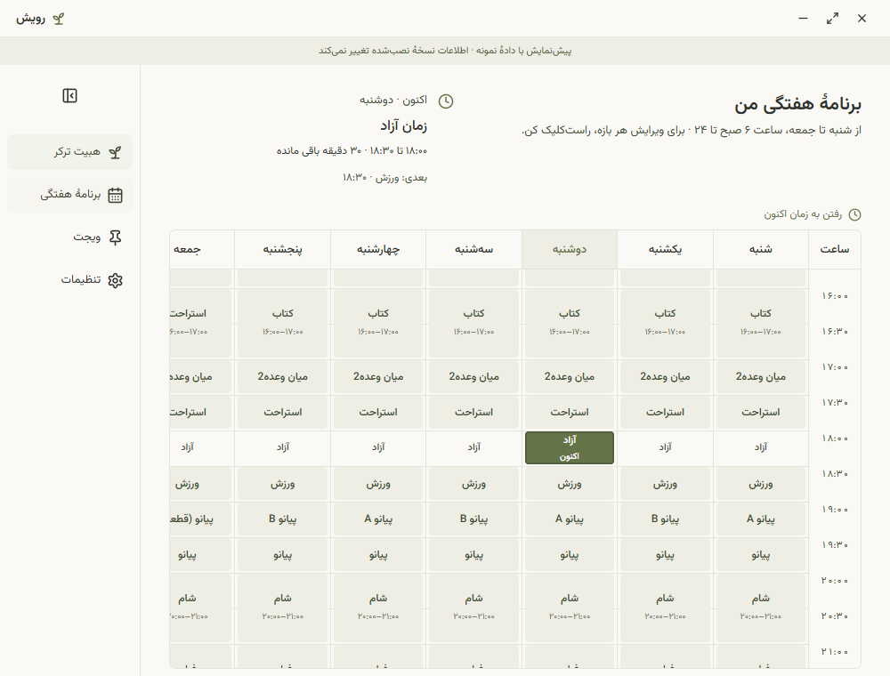
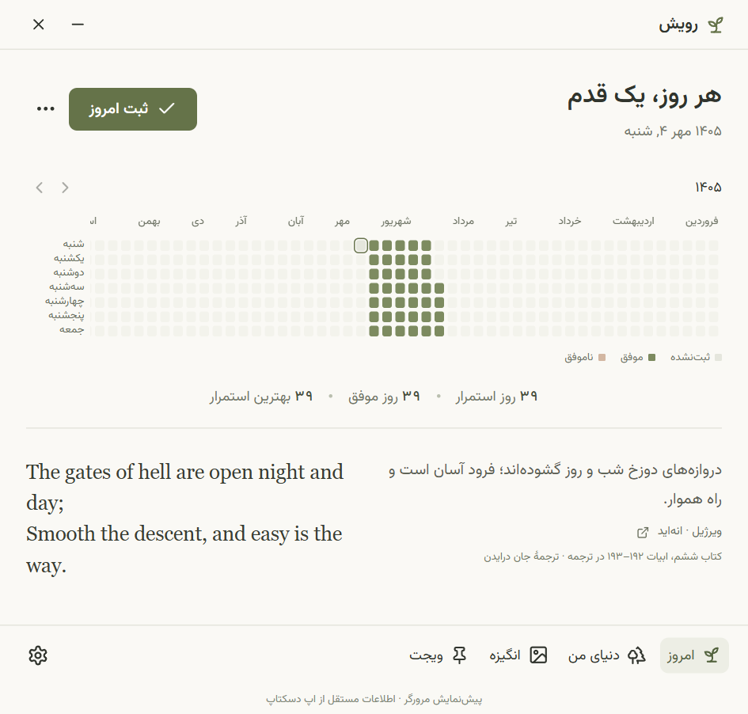
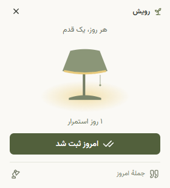
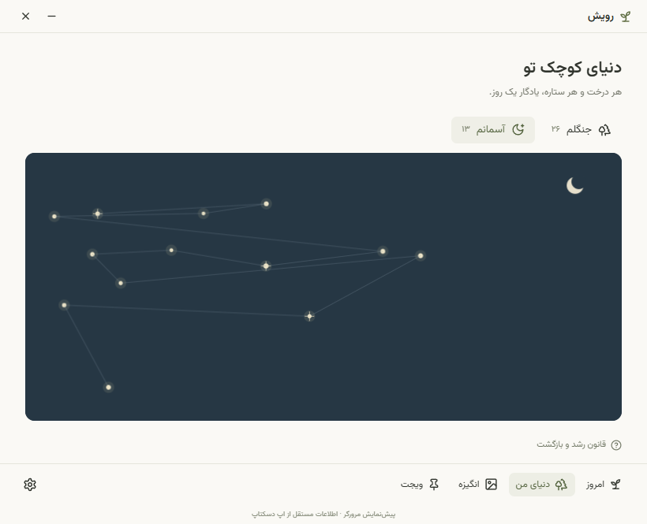
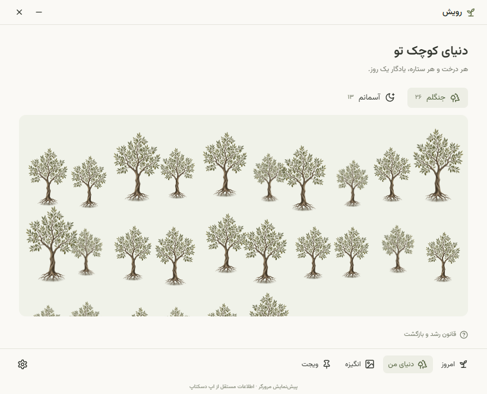

# رویش

همراه آفلاین ویندوز برای یک هدف شخصی: تقویم شمسی، ثبت روزانه، هیت‌مپ، ۱۰۰ نقل‌قول دوزبانه، کتابخانهٔ عکس/فیلم و ویجت همیشه‌بالا.

<p align="center">
  
  &nbsp;&nbsp;
  
  &nbsp;&nbsp;
  
  &nbsp;&nbsp;
  
  &nbsp;&nbsp;
  
  &nbsp;&nbsp;
  
</p>


## اجرا و ساخت

Node.js نسخهٔ ۲۲٫۱۲ یا جدیدتر و ویندوز ۱۰/۱۱ نسخهٔ ۶۴بیتی لازم است. دریافت وابستگی‌های توسعه نیاز به اینترنت دارد؛ اپ ساخته‌شده آفلاین اجرا می‌شود.

```powershell
npm ci
npm run dev
npm test
npm run build
npm start
npm run dist
```

خروجی نصاب در `release/Royesh Setup 1.0.0.exe` قرار می‌گیرد. نصب روی حساب کاربر انجام می‌شود. بسته امضای تجاری ندارد. `npm run dev:web` فقط پیش‌نمایش مرورگر است؛ فایل‌ها و قابلیت‌های سیستم در نسخهٔ دسکتاپ فعال‌اند و داده‌های پیش‌نمایش از اپ مستقل است.

## استفاده

۱. نام هدف و تاریخ شروع را وارد کن. تاریخ شروع می‌تواند گذشته باشد؛ روزهای بین شروع و امروز را از هیت‌مپ تعیین کن.

۲. «ثبت امروز» موفقیت را ثبت می‌کند. برای روز ناموفق یا اصلاح، از دکمهٔ سه‌نقطه یا خانهٔ آن روز استفاده کن. تاریخ آینده قابل ثبت نیست.

۳. برای هر روز موفقِ مجاز، جنگل یا آسمان را انتخاب کن. اگر انتخاب را ببندی، از «روز آمادهٔ رشد» یا صفحهٔ دنیای من دوباره در دسترس است. هر روز فقط یک انتخاب دارد.

۴. بخش انگیزه را روشن و فایل‌ها را وارد کن. فایل اصلی دست‌نخورده می‌ماند. عکس عمودی و افقی با نسبت اصلی نمایش داده می‌شوند؛ قاب ثابت و پرکردن قاب اختیاری‌اند. فیلم پخش خودکار ندارد و با مخفی‌شدن پنجره متوقف می‌شود. ویجت فقط عکس نمایش می‌دهد.

۵. ویجت را از نوار پایین روشن کن. کشیدن نوار عنوان جای آن را عوض می‌کند. جملهٔ روز باز و بسته می‌شود؛ نشان چراغ بین کارت و چراغ جابه‌جا می‌کند. عکس ویجت تنظیم مستقل دارد.

۶. با بستن پنجره، برنامه در کنار ساعت ویندوز باقی می‌ماند؛ خروج کامل از منوی آن است. یادآوری پیش‌فرض ۲۱ و شروع با ویندوز اختیاری است. برنامهٔ کاملاً بسته یادآوری نمی‌فرستد. اعلان‌ها به اجازه و حالت مزاحم‌نشوید ویندوز هم وابسته‌اند.

## قوانین رشد

- در آغاز، هر روز موفق امکان رشد دارد.
- اولین شکستِ یک استریک موفق، ۷ روز موفق متوالی برای بازگشت می‌خواهد. رشد از روز هشتم آزاد می‌شود.
- شکست وسط دوره، شمارش همان دوره را صفر می‌کند.
- شکست پس از پایان دوره، دورهٔ بعد را به ۱۴، سپس ۲۱ روز و… افزایش می‌دهد.
- روز نامشخص، محاسبه را از همان نقطه معلق می‌کند؛ جریمهٔ تازه‌ای ایجاد نمی‌کند. ثبت آن، ادامهٔ تاریخچه را دوباره محاسبه می‌کند.
- رشدهای قبلی با شکست حذف نمی‌شوند. روزهای دوره، رشد ذخیره نمی‌کنند. اصلاح یا پاک‌کردن ثبت گذشته ممکن است رشدهایی را که دیگر مجاز نیستند حذف کند؛ برنامه پیش از اصلاح هشدار می‌دهد.
- تغییر نام، تاریخچه را نگه می‌دارد. هدف جدید، هدف قبلی را با تأیید آرشیو می‌کند. مسیرهای قبلی فقط‌خواندنی‌اند.

## داده و پشتیبان

در نسخهٔ نصب‌شده، پوشهٔ داده معمولاً `%APPDATA%/royesh` یا `%APPDATA%/Royesh` است (نام پوشه از نام اپ Electron گرفته می‌شود). `state.json` شامل ثبت‌ها، تنظیمات و انتخاب جمله‌ها است؛ `state.json.bak` آخرین نسخهٔ قبلی و `media` کتابخانهٔ شخصی است. برای پشتیبان دستی، ابتدا از اپ کامل خارج شو و **کل پوشه** را کپی کن. رمزگذاری یا آپلود وجود ندارد. حذف نصاب، طبق تنظیم بسته، نباید دادهٔ کاربر را حذف کند.

در خرابی فایل اصلی، آخرین نسخهٔ سالم بازیابی و فایل خراب برای بررسی حفظ می‌شود. اگر هیچ نسخهٔ سالمی نباشد، برنامه بدون بازنویسی داده متوقف می‌شود.

## محتوای نقل‌قول

متن و انتساب در `src/data/quotes.ts` و گزارش تطبیق در `docs/quote-verification.json` است. ترجمه‌های فارسی برای این اپ تهیه شده‌اند. برخی جمله‌ها گزیده‌ای از یک بند یا شعرند؛ برای متن کامل روی نام اثر کلیک کن. بازشدن منبع در مرورگر تنها ارتباط اختیاری با اینترنت است.

## آزمون‌های توسعه

`npm test`: منطق استمرار و جریمه، تقویم شمسی، چرخهٔ ۱۰۰ جمله، اعلان و ذخیره‌سازی.

`node scripts/browser-check.mjs`: سرور موقت Vite را خودش اجرا می‌کند؛ گردش کار مرورگر و عکس‌های بررسی رابط را با Edge نصب‌شده می‌سنجد.

`node scripts/electron-check.mjs` و `node scripts/native-edge-check.mjs`: پس از `npm run build`، آزمون واقعی پنجره‌ها، مدیا، ذخیره‌سازی و بازگشت سیستم؛ همه با دادهٔ جداگانه در پوشهٔ `tmp`. برای تست نسخهٔ بسته‌بندی‌شده، متغیر `ROYESH_TEST_EXE` را به مسیر `Royesh.exe` تنظیم کن.

`node scripts/verify-quotes.mjs`: تطبیق متن انگلیسی با صفحات منابع، نیازمند اینترنت؛ نتیجه در `tmp/quote-source-report.json`.

## محدودیت‌های نسخهٔ اول

یک هدف فعال، بدون حساب و همگام‌سازی؛ بدون قفل یا رمزگذاری اختصاصی. همیشه‌بالابودن ویجت روی دسکتاپ امن یا همهٔ بازی‌های تمام‌صفحه تضمین نمی‌شود. پخش MP4/WebM به کدک داخل فایل بستگی دارد. رشد و چراغ بازخورد شخصی‌اند، نه ارزیابی پزشکی.
